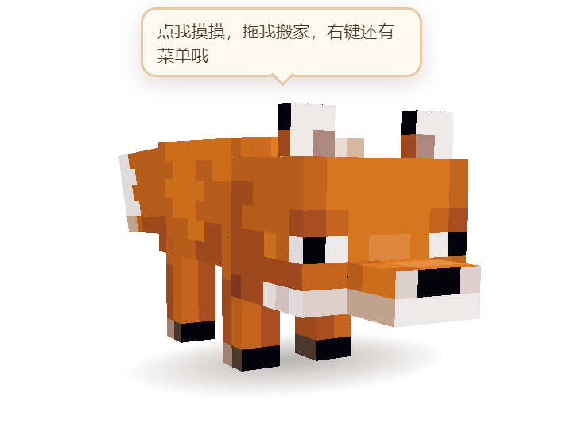
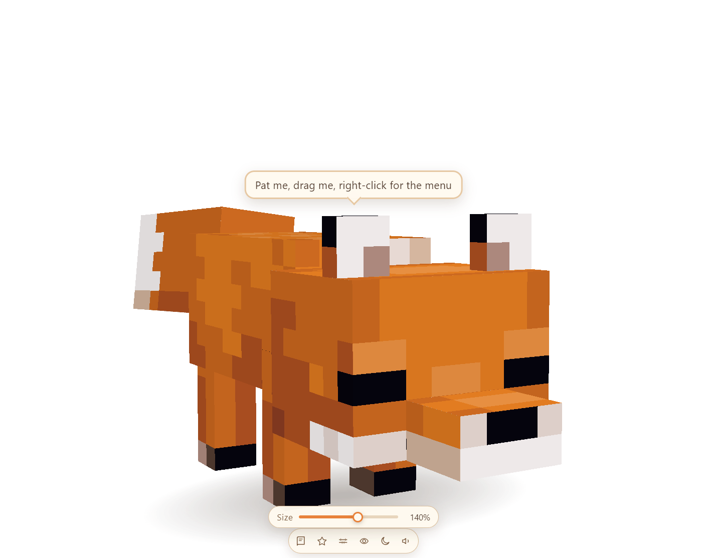
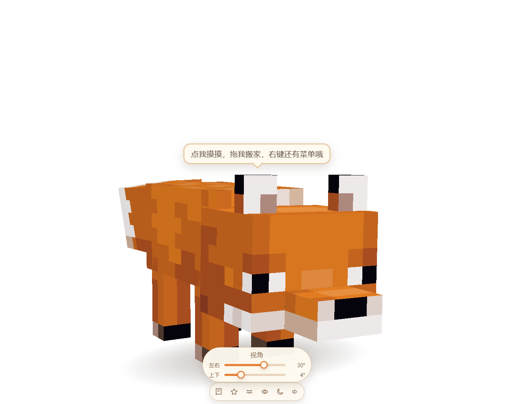
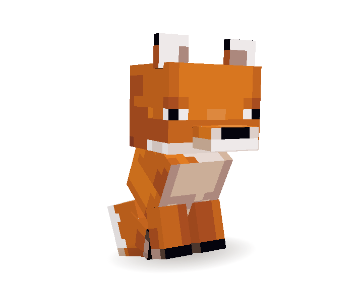
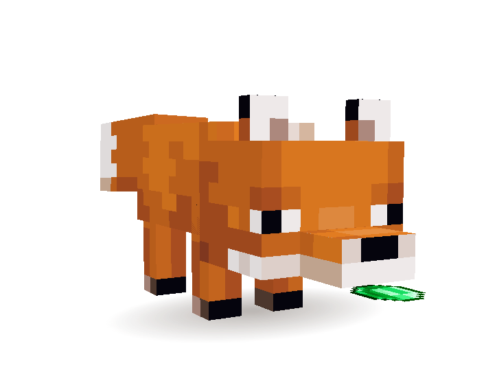
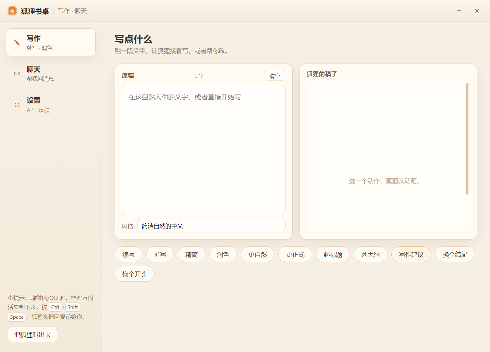
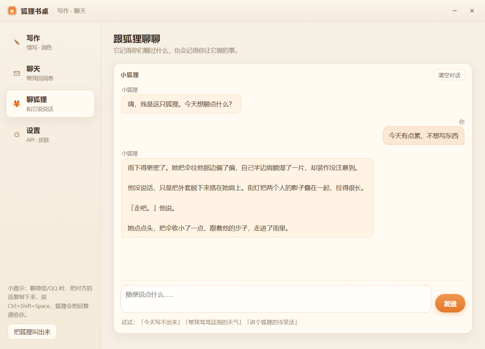
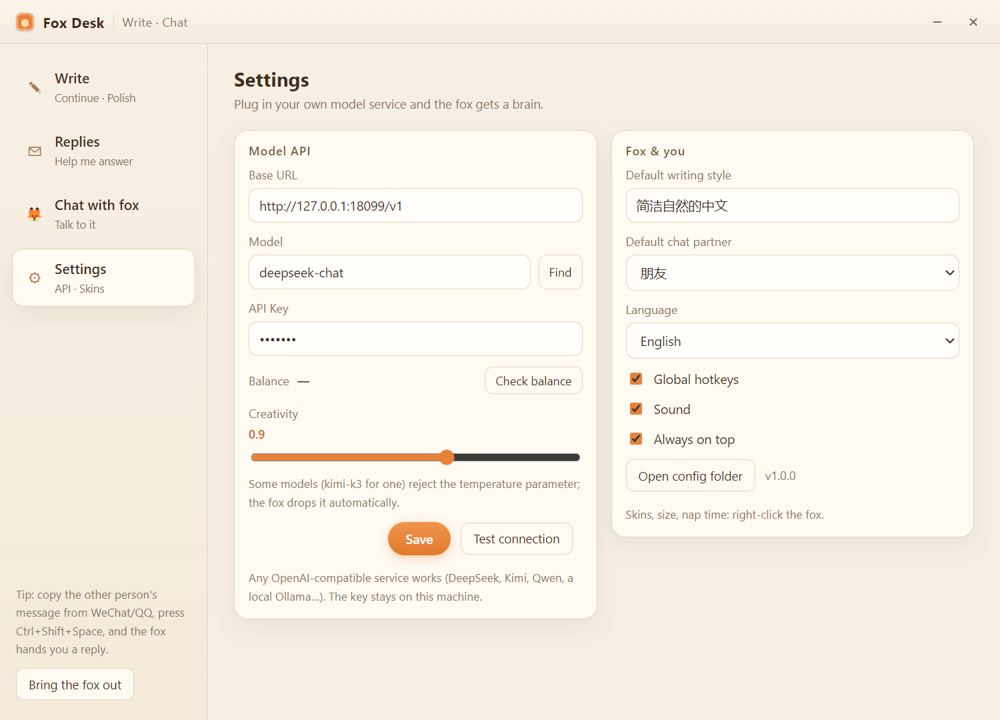
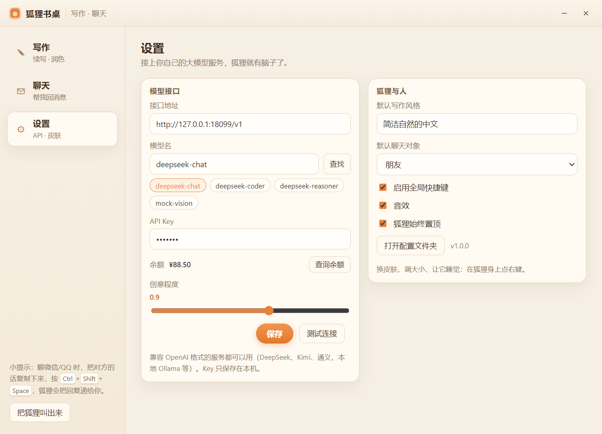

# 🦊 Fox Desk · a Minecraft fox on your desktop

**English** | [简体中文](README.zh-CN.md)

[](LICENSE)
[](#installers)
[](https://www.electronjs.org/)
[](https://threejs.org/)
[](#installers)

A Minecraft fox that lives on your desktop. It renders your own pixel textures in real time with Three.js, breathes, wags its tail, looks around, yawns, curls up for a nap — and sits next to you while you write, or helps you answer chats.



- [What it does](#what-it-does)
- [Quick start](#quick-start)
- [Installers](#installers)
- [Model API](#model-api)
- [Development](#development)
- [Known limits](#known-limits)

## What it does

**The pet**

- A transparent, frameless, always-on-top window: the fox really stands on your desktop, with a soft shadow.
- 4 skins: red fox / snow fox / red cub / snow cub — from the right-click menu or the hover toolbar. The cubs are a **separate model** (big head, short legs, thick tail, their own 64×32 atlas), not a scaled-down adult.
- Clicks: pet it → happy hop, hearts, a line; double-click → spin; drag → it dangles and kicks, and bounces when you drop it.
- Idle animations: breathing, tail wag, blinking, looking around, sitting, scratching, grooming, stretching, pouncing, spinning, pacing — and a nap (`zzZ`) if you ignore it long enough; click to wake it.
- Size slider (ruler icon, or right-click → Resize): 50 %–200 %. **Only the fox changes** — the window is a fixed 940×740 and the scaling happens inside the 3D scene, so the toolbar, sliders and speech bubble never move by a pixel.
- Camera sliders (eye icon): two bars, left–right (−90°…90°) and up–down (−12°…55°), so you can look at its side or the top of its head.
- You can drag it all the way to the top of the screen; it stays where you drop it (the window may hang off the edge, the fox never snaps back).
- Mouth items: right-click → “Holding” and give it an emerald, raw/cooked chicken, raw rabbit, rabbit’s foot, egg or wheat. It holds the item flat in its mouth, half bitten in. The icons are the vanilla item textures fetched from blockrender.dev and converted back to 16×16 (`scripts/make_items.py` re-fetches them).
- Optional gravity: right-click → “Drop to the taskbar”, and the fox falls until its paws hit the taskbar; dragging pauses the fall, releasing resumes it.
- Right-click menu: open the desk, write something, skins, resize, view, holding, sleep / wake, gravity, sound, always on top, quit.

|  |  |
| --- | --- |
| Only the fox scales | Two bars: left–right, up–down |

|  |  |
| --- | --- |
| The cub has its own model | Mouth items, half bitten in |

**The desk (writing + replies)**

- **Write**: paste a draft and pick *continue / expand / shorten / polish / more natural / more formal / title / outline / writing tips / new ending / new opening*. Streams the result, one click to copy.
- **Replies**: paste a WeChat/QQ conversation, pick who you are talking to (friend, colleague, someone you like, snarky friend, elder relative, customer support) and how many lines, and get lines you can send as they are.
- **Chat with fox**: just talk to it; it keeps the last 14 messages and answers in character.
- **English / 简体中文**: switch in Settings → Language (Follow installer / 中文 / English); both windows re-render instantly.
- **No window switching**: copy the other person's message in any app, press `Ctrl`+`Shift`+`Space`, and the desk pops up on the replies tab with the clipboard already in the box — copy → hotkey → click a line → paste back. That is the “get a reply without typing into the chat box” flow.
- `Ctrl`+`Shift`+`W`: open the desk on the writing tab with the clipboard text; `Ctrl`+`Shift`+`F`: hide / show the fox.

|  |  |  |
| --- | --- | --- |
| Write | Chat with the fox | English UI |

## Quick start

Node.js 18+.

```bash
npm install          # or pnpm install
npm start            # or pnpm start
```

`npm start` runs `scripts/launch.js`, which clears `ELECTRON_RUN_AS_NODE` before starting Electron — otherwise it dies with `protocol.registerSchemesAsPrivileged` of undefined.

If the Electron binary did not download (`node_modules/electron/dist/electron.exe` missing):

```bash
node node_modules/electron/install.js
# behind the GFW you can use a mirror:
# ELECTRON_MIRROR=https://npmmirror.com/mirrors/electron/ node node_modules/electron/install.js
```

> pnpm 11 skips dependency build scripts, so electron's postinstall may be skipped. Either `pnpm approve-builds` or run the `install.js` command above.

## Installers

`dist/` holds four artifacts — two languages × two shapes:

| File | Default language | What it is |
| --- | --- | --- |
| `狐狸书桌-1.0.0-portable.zip` | 中文 | **Recommended.** Portable, no install: unzip, double-click 安装快捷方式.cmd; installs to `%LOCALAPPDATA%\Programs\狐狸书桌` |
| `Fox-Desk-1.0.0-portable-en.zip` | English | Same, English build: unzip, double-click `install.cmd`; installs to `%LOCALAPPDATA%\Programs\Fox Desk` |
| `fox-desk-setup-1.0.0.exe` | 中文 | Classic NSIS installer (~88 MB). **Unsigned** — Windows 11 Smart App Control blocks it |
| `fox-desk-en-setup-1.0.0.exe` | English | The English variant of the above (Fox Desk) |

Both portable bundles create Desktop + Start Menu shortcuts and register an entry in Settings → Apps; uninstalling removes the program only and keeps your settings in `%APPDATA%\mc-fox-pet`. The default language lives in each bundle's `resources/app/package.json` (`defaultLang`) and can be changed in Settings at any time.

Why the portable bundle is the recommended one: this machine (like many fresh Windows 11 installs) has Smart App Control enabled, so unsigned executables are refused with `An Application Control policy has blocked this file`. The portable bundle keeps the **signed** Electron binary as the launcher and only copies files + creates shortcuts, so no unsigned PE ever runs. The price is size (~269 MB, ~115 MB zipped).

What the installer script does:

- copies the bundle to `%LOCALAPPDATA%\Programs\<productName>` (no admin rights needed)
- creates Desktop / Start Menu shortcuts with the fox icon
- registers `HKCU\...\Uninstall\FoxDesk-<lang>` so Settings → Apps can uninstall it
- uninstalling removes the program only; chat / writing settings stay in `%APPDATA%\mc-fox-pet`

Rebuilding:

```bash
npm run icon                 # regenerate build/icon.ico (composited from .inspect/icon_sit.png)

npm run portable             # Chinese portable -> dist/portable-zh/狐狸书桌
npm run portable:en          # English portable -> dist/portable-en/Fox Desk

npm run dist                 # Chinese installer -> dist/fox-desk-setup-1.0.0.exe
npm run dist:en              # English installer -> dist/fox-desk-en-setup-1.0.0.exe
```

`scripts/dist.js` overrides `productName` / `defaultLang` / shortcut name / artifact name per language, so both installers can coexist (different folders, different uninstall entries). electron-builder occasionally fails with `spawn UNKNOWN` because Smart App Control refuses to run the freshly built *unsigned uninstaller*; just run the command again (1–3 tries).

Behind a TLS-inspecting network, electron-builder needs the mirrors (otherwise it stops at `unable to verify the first certificate`):

```bash
ELECTRON_MIRROR=https://npmmirror.com/mirrors/electron/
ELECTRON_BUILDER_BINARIES_MIRROR=https://npmmirror.com/mirrors/electron-builder-binaries/
CSC_IDENTITY_AUTO_DISCOVERY=false
```

electron-builder also shells out to `pnpm list --prod --json`; if pnpm is not on PATH, add a shim (see `.inspect/bin/pnpm.cmd`).

## Model API

On first run (no API key yet) the Settings tab opens automatically; you can also right-click the fox → open desk → Settings.

| Field | Notes |
| --- | --- |
| Base URL | Defaults to `https://api.deepseek.com/v1`; point it at any OpenAI-compatible `.../v1` endpoint (Kimi, Qwen, local Ollama, ...) |
| Model | Defaults to `deepseek-chat`; hit **Find** to list the models your key can use and click one, or type any model name |
| API Key | Stored locally only, never uploaded |
| Creativity | 0–1.5, shared by writing and replies; some models (e.g. kimi-k3) reject `temperature` — the fox drops it automatically and remembers |
| Balance | **Check balance** reads `/user/balance` (DeepSeek); other services just report “not available” and everything else keeps working |

Settings live in `%APPDATA%\mc-fox-pet\config.json` (Settings → Open config folder).



## Development

```bash
npm start            # normal launch
npm run dev          # same (dev marker reserved)
npm run shot         # screenshot the pet window to .inspect/shot.png and exit
npm run panel        # screenshot the desk window to .inspect/panel.png and exit
```

You can drive the renderer directly for debugging:

```bash
node scripts/launch.js --pet-query="state=sit&yaw=0.6&pitch=0.1&dist=46&ty=9.8"
node scripts/launch.js --panel-shot=.inspect/panel.png --panel-tab=chat
node scripts/launch.js --pet-query="skin=red_baby&item=emerald&ui=none"
```

Layout:

```
src/
  main/        main.js (windows / protocol / menus / hotkeys / IPC), store.js, ai.js, skins.js, i18n.js
  i18n/        zh.json, en.json
  preload/     pet.js, panel.js (the minimal contextBridge APIs)
  renderer/
    pet/       fox rendering: foxmodel.js (model + UVs), anim.js (animation state machine), pet.js, index.html, style.css
    panel/     desk UI: index.html, style.css, panel.js
assets/textures/  atlases (adult fox / fox_snow 48×32; cub cub_red / cub_snow 64×32, each with a sleep frame)
assets/items/     mouth-item icons (16×16, vanilla textures)
assets/icon.ico   window / shortcut icon
scripts/       launch.js, gen_cub_atlas.py (repacks the adult atlas into the cub 64×32 atlas), make_items.py, make_icon.py, make_portable.js, dist.js
packaging/     portable install / uninstall scripts and readmes (copied into dist/portable-*)
.inspect/      development screenshots and reference tools (not shipped)
```

The adult is rebuilt from the vanilla Java 1.20.1 fox box model: head 8×6×6, body 6×11×6, tail 4×9×5, legs 2×6×2, ears 2×2×1, using the standard 48×32 unwrap — so vanilla (or vanilla-style) fox textures work as-is.

The cub is its own model: head 10×8×8, body 7×8×7, tail 5×8×6, legs 3×5×3, ears 3×3×1, snout 5×2×3, with a 64×32 atlas. Both models share the same skeleton and pivots, so every idle / sit / sleep / drag animation works for the cub too.

All 8 texture images you provided are kept in `assets/textures/`. The 4 adult ones (`fox` / `fox_sleep` / `fox_snow` / `fox_snow_sleep`) are standard 48×32 unwraps and are used directly. The 4 cub ones are 32×32 hand-painted layouts that do not match a box unwrap, so `scripts/gen_baby_atlas.py` derives `baby_red` / `baby_snow` (with sleep frames, bigger eyes, warmer fur) from the adult atlas. To change how the cubs look, edit those derived atlases.

## Known limits

- Windows 10/11, per-monitor DPI aware. The pet window is a fixed 940×740 DIP and the fox scales inside it; dragging never resizes the window.
- The window may hang off the display edge (that is how the fox reaches the top of the screen); it is clamped so its centre always stays on a display.
- Without an API key, writing / replies point you at Settings; the pet itself works offline.
- The NSIS installers are unsigned: on machines with Smart App Control enabled, use the portable zip instead.
- If another terminal exports `ELECTRON_RUN_AS_NODE=1`, use `npm start` (the launcher handles it) instead of `electron .` directly.

---

Not affiliated with Mojang or Microsoft. Minecraft is a trademark of Mojang Synergies AB; the fox textures and item icons are fan assets used for a personal desktop pet.
