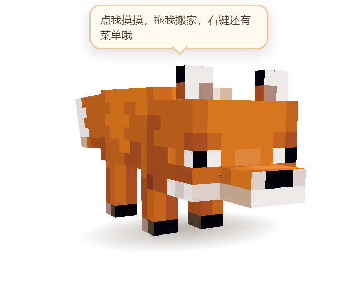
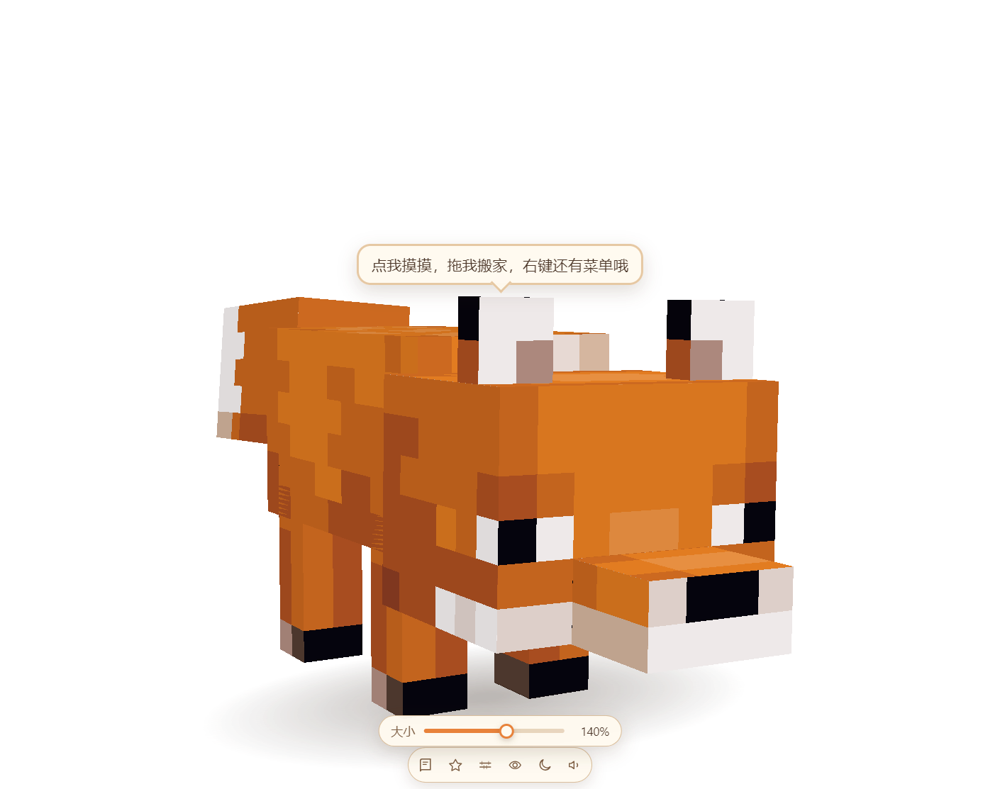
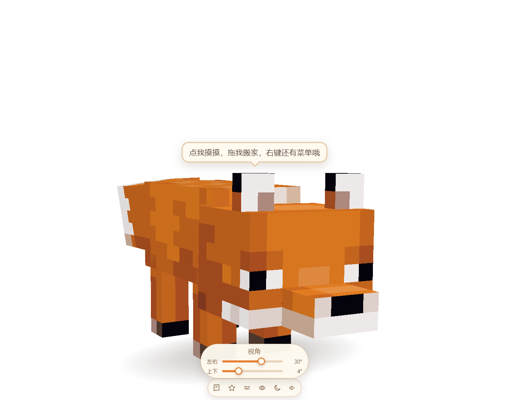
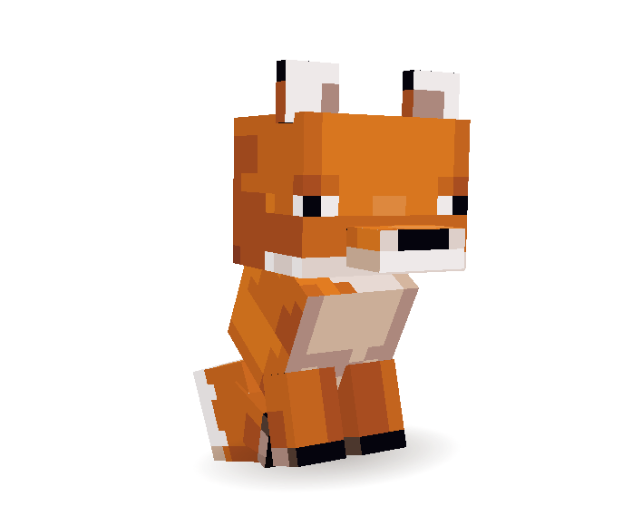
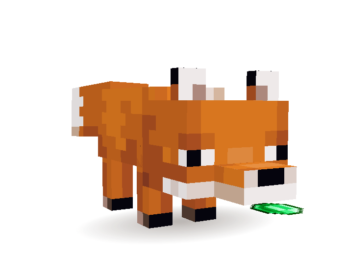
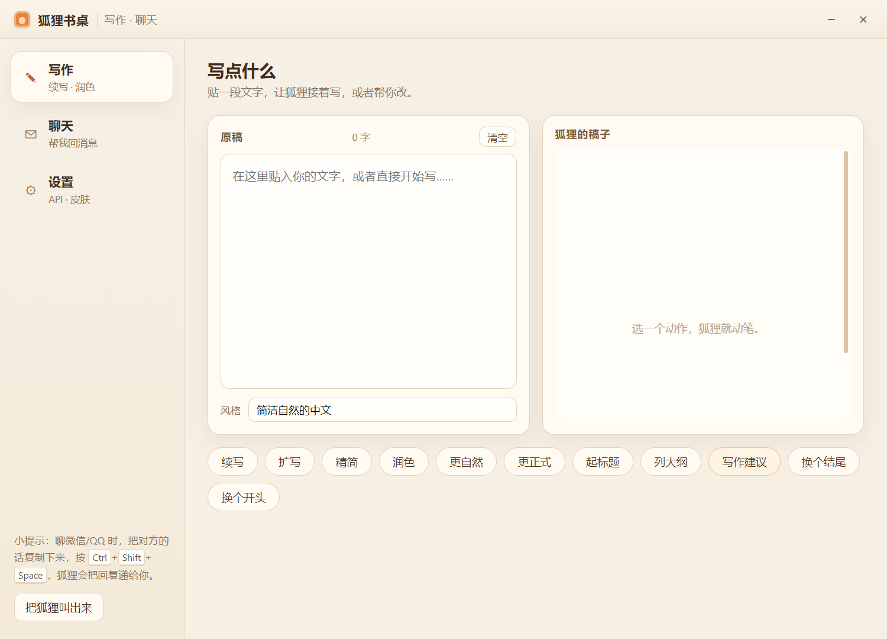
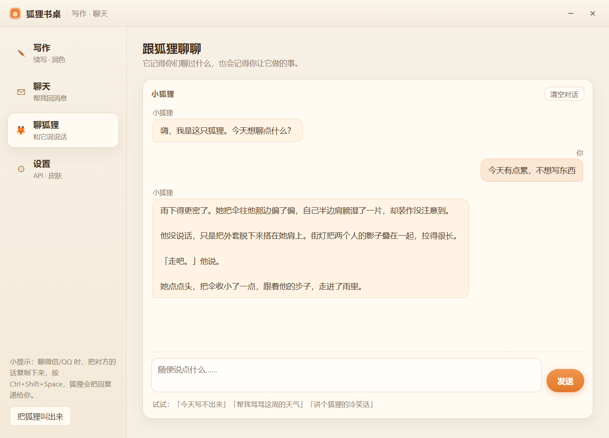
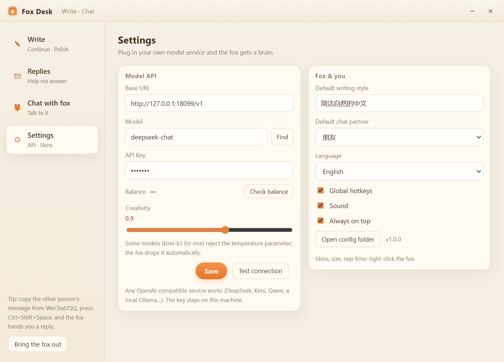
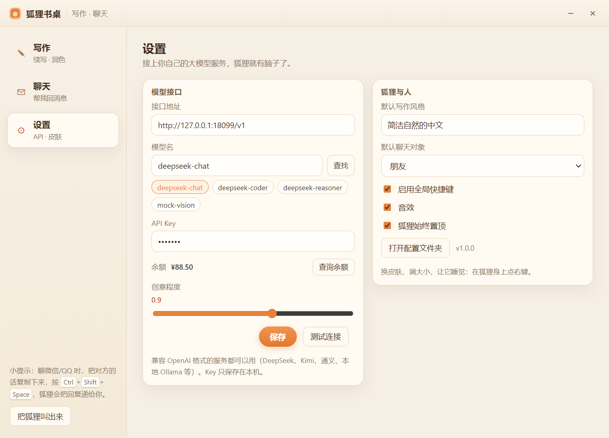

# 🦊 狐狸书桌 · Minecraft 狐狸桌宠

[English](README.md) | **简体中文**

[](LICENSE)
[](#%E5%AE%89%E8%A3%85%E5%8C%85)
[](https://www.electronjs.org/)
[](https://threejs.org/)

一只住在桌面上的 Minecraft 狐狸。它用你自己的像素贴图实时渲染（Three.js）——会呼吸、甩尾巴、东张西望、打哈欠、趴下打盹，陪你写东西，帮你想聊天回复。



- [功能一览](#%E5%8A%9F%E8%83%BD%E4%B8%80%E8%A7%88)
- [快速开始](#%E5%BF%AB%E9%80%9F%E5%BC%80%E5%A7%8B)
- [安装包](#%E5%AE%89%E8%A3%85%E5%8C%85)
- [接入模型](#%E6%8E%A5%E5%85%A5%E6%A8%A1%E5%9E%8B)
- [开发](#%E5%BC%80%E5%8F%91)
- [已知边界](#%E5%B7%B2%E7%9F%A5%E8%BE%B9%E7%95%8C)

## 功能一览

**桌宠**

- 透明无边框、始终置顶的独立窗口，狐狸真的站在桌面上（带软阴影）。
- 4 套皮肤：赤狐 / 雪狐 / 赤狐幼崽 / 雪狐幼崽；右键菜单或悬停工具栏都能换。**幼崽是另一套模型**（大头、短腿、粗尾巴、独立的 64×32 贴图），不是把成体缩小。
- 点击互动：摸头 → 开心跳、爱心、说话；双击 → 转圈；拖拽 → 被拎起来晃（四肢乱蹬），松手落地会弹一下。
- 待机动画：呼吸、甩尾、眨眼、东张西望、坐下、挠痒、舔毛、伸懒腰、扑跳、原地转圈、来回踱步，久不理它会趴下睡觉（`zzZ`），点一下叫醒。
- 大小条（工具栏的尺子图标，或右键「调整大小」）：50 %–200 %。**只有狐狸在变**——窗口固定 940×740，缩放发生在 3D 场景里，所以工具栏、滑条、气泡一个像素都不会动。
- 视角条（眼睛图标）：两根，左右 −90°…90°、上下 −12°…55°，可以看侧面或者头顶。
- 能一直拖到屏幕最上面，松手就停在那儿；窗口可以挂到屏幕外面，狐狸不会「啪」一下被拽回来。
- 嘴里叼东西：右键「嘴里叼着」可以选绿宝石、生/熟鸡肉、生兔肉、兔脚、鸡蛋、小麦。狐狸平着叼在嘴里，一半咬进去、一半露在外面。图标是原版物品贴图，从 blockrender.dev 抓下来还原成 16×16（`scripts/make_items.py` 可重新抓）。
- 可选重力：右键「掉到任务栏（重力）」，狐狸会往下掉，直到爪子搭在任务栏上；拖动时暂停，松手继续。
- 右键菜单：打开书桌、写点东西、换皮肤、调整大小、视角、嘴里叼着、睡觉 / 叫醒、重力、音效、始终置顶、退出。

|  |  |
| --- | --- |
| 只有狐狸在缩放 | 左右、上下两根滑条 |

|  |  |
| --- | --- |
| 幼崽是独立模型 | 嘴里的东西咬一半 |

**书桌（写作 + 聊天）**

- **写作**：贴一段稿子，选「续写 / 扩写 / 精简 / 润色 / 更自然 / 更正式 / 起标题 / 列大纲 / 写作建议 / 换个结尾 / 换个开头」，流式输出，一键复制。
- **聊天**：把微信 / QQ 的聊天记录粘进去，选对方是谁（朋友、同事、心动对象、幽默损友、长辈、客服）和条数，狐狸给几条能直接发出去的话，点一下就复制。
- **聊狐狸**：像跟朋友聊天一样跟它说话，它记得最近 14 条消息，会用狐狸的口吻回你。
- **中英双语**：设置 → 语言（跟随安装包 / 中文 / English），两个窗口立刻切换。
- **不用切窗口**：在任何软件里复制对方的话，按 `Ctrl`+`Shift`+`Space`，书桌会带着剪贴板内容弹出并切到聊天页——这就是「不用在聊天框里打字也能拿到回复」的用法：复制 → 热键 → 点一条 → 回聊天框粘贴。
- `Ctrl`+`Shift`+`W`：带着剪贴板内容打开写作页；`Ctrl`+`Shift`+`F`：把狐狸藏起来 / 叫出来。

|  |  |  |
| --- | --- | --- |
| 写作 | 聊狐狸 | 英文界面 |

## 快速开始

需要 Node.js 18+。

```bash
npm install          # 或 pnpm install
npm start            # 或 pnpm start
```

`npm start` 实际走 `scripts/launch.js`，它会清掉 `ELECTRON_RUN_AS_NODE` 再启动 Electron，避免「`protocol.registerSchemesAsPrivileged` of undefined」这种启动崩溃。

如果 Electron 的二进制没下下来（`node_modules/electron/dist/electron.exe` 不存在），补一条：

```bash
node node_modules/electron/install.js
# 国内网络可以指定镜像：
# ELECTRON_MIRROR=https://npmmirror.com/mirrors/electron/ node node_modules/electron/install.js
```

> pnpm 11 默认不执行依赖的构建脚本，`electron` 的 postinstall 会被跳过。出现这种情况时用 `pnpm approve-builds` 允许，或者直接跑上面的 `install.js`。

## 安装包

`dist/` 下是四个成品——两种语言 × 两种形态：

| 文件 | 默认语言 | 说明 |
| --- | --- | --- |
| `狐狸书桌-1.0.0-portable.zip` | 中文 | **推荐**。免安装绿色包：解压后双击「安装快捷方式.cmd」，装到 `%LOCALAPPDATA%\Programs\狐狸书桌` |
| `Fox-Desk-1.0.0-portable-en.zip` | 英文 | 同上，英文版：解压后双击 `install.cmd`，装到 `%LOCALAPPDATA%\Programs\Fox Desk` |
| `fox-desk-setup-1.0.0.exe` | 中文 | 常规 NSIS 安装包（约 88 MB）。**未签名**，开着智能应用控制会被拦 |
| `fox-desk-en-setup-1.0.0.exe` | 英文 | 上面那个的英文版（Fox Desk） |

两个绿色包都会建桌面 + 开始菜单快捷方式，并在「设置 → 应用」里登记一个卸载项；卸载只删程序，配置留在 `%APPDATA%\mc-fox-pet`。默认语言写在每个包的 `resources/app/package.json`（`defaultLang`），装完随时能在设置里改。

为什么推荐绿色包：这台机器（以及不少新装的 Win11）开着 Smart App Control，未签名的 exe 会被系统拒绝启动（报 `An Application Control policy has blocked this file`）。绿色包直接用官方签名的 Electron 当启动器，只做「复制文件 + 建快捷方式」，不运行任何未签名程序，因此不会被拦。代价是体积大一些（约 269 MB，压缩后 115 MB）。

安装脚本会做这几件事：

- 把包复制到 `%LOCALAPPDATA%\Programs\<productName>`（不需要管理员权限）
- 用狐狸图标建桌面 / 开始菜单快捷方式
- 写 `HKCU\...\Uninstall\FoxDesk-<lang>`，让「设置 → 应用」可以卸载
- 卸载只删程序，聊天 / 写作的配置留在 `%APPDATA%\mc-fox-pet`

重新打包：

```bash
npm run icon                 # 重新生成 build/icon.ico（由 .inspect/icon_sit.png 合成）

npm run portable             # 中文绿色包 -> dist/portable-zh/狐狸书桌
npm run portable:en          # 英文绿色包 -> dist/portable-en/Fox Desk

npm run dist                 # 中文安装包 -> dist/fox-desk-setup-1.0.0.exe
npm run dist:en              # 英文安装包 -> dist/fox-desk-en-setup-1.0.0.exe
```

`scripts/dist.js` 会按语言覆盖 `productName` / `defaultLang` / 快捷方式名 / 产物名，所以两个安装包可以共存（不同目录、不同卸载项）。electron-builder 偶尔会报 `spawn UNKNOWN`——那是因为它要把刚打出来的**未签名卸载器**跑一遍，被 Smart App Control 拒了；再跑一次就行（一般 1–3 次）。

网络有 TLS 拦截时，electron-builder 需要镜像，否则会停在 `unable to verify the first certificate`：

```bash
ELECTRON_MIRROR=https://npmmirror.com/mirrors/electron/
ELECTRON_BUILDER_BINARIES_MIRROR=https://npmmirror.com/mirrors/electron-builder-binaries/
CSC_IDENTITY_AUTO_DISCOVERY=false
```

electron-builder 还会调用 `pnpm list --prod --json`；pnpm 不在 PATH 上时补一个 shim（见 `.inspect/bin/pnpm.cmd`）。

## 接入模型

首次运行（还没填 API Key）会自动打开设置页；也可以右键狐狸 → 打开书桌 → 设置。

| 字段 | 说明 |
| --- | --- |
| 接口地址 | 默认 `https://api.deepseek.com/v1`；任何兼容 OpenAI 的 `.../v1` 都能填（Kimi、通义、本地 Ollama……） |
| 模型名 | 默认 `deepseek-chat`；点「查找」可以列出这把 Key 能用的模型并点选，也可以直接手填 |
| API Key | 只存在本机，不会上传 |
| 创意程度 | 0–1.5，写作和聊天共用；有些模型（比如 kimi-k3）不接受 `temperature`，狐狸会自动省略并记住 |
| 余额 | 「查询余额」读 `/user/balance`（DeepSeek 系）；别的服务只会提示「查不到」，其它功能照常 |

配置在 `%APPDATA%\mc-fox-pet\config.json`（设置 → 打开配置文件夹）。



## 开发

```bash
npm start            # 正常启动
npm run dev          # 同上（预留了 dev 标记）
npm run shot         # 截一张桌宠窗口到 .inspect/shot.png 后退出
npm run panel        # 截一张书桌窗口到 .inspect/panel.png 后退出
```

调试时可以直接给渲染进程传参数：

```bash
node scripts/launch.js --pet-query="state=sit&yaw=0.6&pitch=0.1&dist=46&ty=9.8"
node scripts/launch.js --panel-shot=.inspect/panel.png --panel-tab=chat
node scripts/launch.js --pet-query="skin=red_baby&item=emerald&ui=none"
```

目录：

```
src/
  main/        main.js（窗口 / pet:// 协议 / 菜单 / 热键 / IPC）、store.js、ai.js、skins.js、i18n.js
  i18n/        zh.json、en.json
  preload/     pet.js、panel.js（最小的 contextBridge API）
  renderer/
    pet/       狐狸渲染：foxmodel.js（模型 + UV）、anim.js（动画状态机）、pet.js、index.html、style.css
    panel/     书桌界面：index.html、style.css、panel.js
assets/textures/  贴图（成体 fox / fox_snow 48×32；幼崽 cub_red / cub_snow 64×32，各含睡眠帧）
assets/items/     嘴里叼的物品图标（16×16，原版贴图）
assets/icon.ico   窗口 / 快捷方式图标
scripts/       launch.js、gen_cub_atlas.py（把成狐贴图重排成幼崽 64×32 图集）、make_items.py（抓物品图标）、make_icon.py、make_portable.js、dist.js
packaging/     绿色包的安装 / 卸载脚本和使用说明（打包时复制进 dist/portable-*）
.inspect/      开发截图和参考工具（不随包发布）
```

成体模型按原版 Java 1.20.1 狐狸的方块模型重建：头 8×6×6、身体 6×11×6、尾巴 4×9×5、腿 2×6×2、耳朵 2×2×1，用标准 48×32 展开——所以原版（或原版风格）的狐狸贴图可以直接用。

幼崽是独立模型：头 10×8×8、身体 7×8×7、尾巴 5×8×6、腿 3×5×3、耳朵 3×3×1、吻部 5×2×3，配 64×32 图集。两套模型共用同一套骨架和枢轴，所以坐下 / 睡觉 / 被拎起来这些动画幼崽也都有。

你给的 8 张贴图都保留在 `assets/textures/`：4 张成体的（`fox` / `fox_sleep` / `fox_snow` / `fox_snow_sleep`）是标准 48×32 展开，直接用；4 张幼崽的是 32×32 手绘布局、不是方块展开，所以用 `scripts/gen_baby_atlas.py` 从成体图集派生出 `baby_red` / `baby_snow`（含睡眠帧、眼睛更大、毛色更暖）。想改幼崽长相就改这两张派生图集。

## 已知边界

- Windows 10/11，支持多显示器不同缩放。桌宠窗口固定 940×740 DIP，狐狸在里面缩放；拖动时窗口尺寸不会变。
- 窗口可以挂到屏幕边缘外（狐狸才够得到屏幕顶部），但会保证狐狸的中心始终落在某个显示器里。
- 没填 API Key 时，写作 / 聊天会提示去设置；桌宠本身离线可用。
- NSIS 安装包未签名：开着智能应用控制的机器请用绿色包。
- 如果别的终端里设了 `ELECTRON_RUN_AS_NODE=1`，用 `npm start`（启动器会处理），别直接 `electron .`。

---

与 Mojang / 微软没有关系。Minecraft 是 Mojang Synergies AB 的商标；这里用到的狐狸贴图和物品图标都是个人桌宠用途的同人素材。
