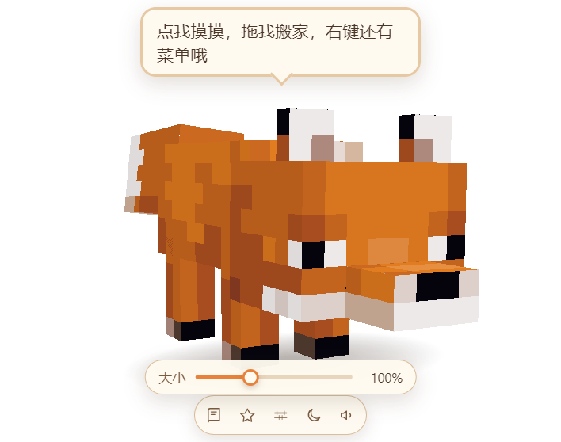

# 🦊 狐狸书桌 · Minecraft 狐狸桌宠

[English](README.md) | **简体中文**

一只住在桌面上的 Minecraft 狐狸。它用你给的像素贴图实时渲染（Three.js），会呼吸、甩尾巴、东张西望、打哈欠、趴下打盹，陪你写东西、帮你想聊天回复。


## 功能一览

**桌宠**

- 透明无边框、始终置顶的独立窗口，狐狸真的站在桌面上（带软阴影）。
- 4 套皮肤：赤狐 / 雪狐 / 赤狐幼崽 / 雪狐幼崽；右键菜单或悬停工具栏都能换。幼崽是**另一套模型**（大头、短腿、粗尾巴，独立 64×32 贴图），不是把成体缩小。
- 点击互动：摸头 → 开心跳、爱心、说话；双击 → 转圈；拖拽 → 被拎起来晃（四肢乱蹬），松手落地会弹一下。
- 待机动画：呼吸、甩尾、眨眼、东张西望、坐下、挠痒、舔毛、伸懒腰、扑跳、原地转圈、来回踱步，久不理它会趴下睡觉（`zzZ`），点一下叫醒。
- 大小拖动条：工具栏里点尺子图标（或右键「调整大小…」）拖滑块，50%–200%；**只有狐狸变，工具栏 / 滑块 / 气泡一动不动**——窗口固定 940×740，缩放发生在 3D 场景里。
- 视角拖动条：工具栏眼睛图标，两根滑块，左右（−90°…90°）和上下（−12°…55°），拖着就能看侧面、头顶。
- 嘴里叼东西：右键「嘴里叼着」可以选绿宝石、生/熟鸡肉、生兔肉、兔脚、鸡蛋、小麦，狐狸平着叼在嘴里（一半咬进嘴，一半露在外面）。图标是原版物品贴图，从 blockrender.dev 抓下来还原成 16×16（`scripts/make_items.py` 可重新抓）。
- 可选重力：右键勾上「掉到任务栏（重力）」，松手 / 启动时狐狸会自己往下掉，脚踩到任务栏停住；拖动时暂停，松手继续掉。
- 右键菜单：打开书桌、写点东西、聊狐狸、换皮肤、调整大小、视角、嘴里叼着、让它睡 / 叫醒、重力、音效、置顶、退出。




**书桌（写作 + 聊天 + 聊狐狸）**

- **写作**：贴一段稿子，选「续写 / 扩写 / 精简 / 润色 / 更自然 / 更正式 / 起标题 / 列大纲 / 写作建议 / 换个结尾 / 换个开头」，流式输出，一键复制。
- **聊天**：把微信 / QQ 的聊天记录粘进去，选对方是谁（朋友、同事、心动对象、损友、长辈、客服）和条数，狐狸给几条能直接发出去的话，点一下就复制。
- **聊狐狸**：直接跟狐狸说话，它记得上下文（最多 14 轮），会用狐狸的口吻回你。
- **中英双语**：设置里有语言下拉（跟随安装包 / 中文 / English），切完两个窗口立即刷新。
- **不用切窗口**：在任何软件里复制对方的话，按 `Ctrl`+`Shift`+`Space`，书桌会带着剪贴板内容弹出并切到聊天页——这就是「不用在聊天框里打字也能拿到回复」的用法：复制 → 热键 → 点一条 → 回聊天框粘贴。
- `Ctrl`+`Shift`+`W`：带着剪贴板内容打开写作页；`Ctrl`+`Shift`+`F`：把狐狸藏起来 / 叫出来。

## 快速开始

需要 Node.js 18+。

```bash
npm install          # 或 pnpm install
npm start            # 或 pnpm start
```

`npm start` 实际走 `scripts/launch.js`，它会清掉 `ELECTRON_RUN_AS_NODE` 再启动 Electron，避免「`protocol.registerSchemesAsPrivileged` of undefined」这种启动崩溃。

如果 Electron 的二进制没下下来（`node_modules/electron/dist/electron.exe` 不存在），补一条：

```bash
node node_modules/electron/install.js
# 国内网络可以指定镜像：
# ELECTRON_MIRROR=https://npmmirror.com/mirrors/electron/ node node_modules/electron/install.js
```

> pnpm 11 默认不执行依赖的构建脚本，`electron` 的 postinstall 会被跳过。出现这种情况时用 `pnpm approve-builds` 允许，或者直接跑上面的 `install.js`。

## 安装包（发给别人 / 装到自己机器）

`dist/` 下有四个成品：

| 文件 | 默认语言 | 说明 |
| --- | --- | --- |
| `狐狸书桌-1.0.0-portable.zip` | 中文 | **推荐**。免安装绿色包：解压后双击「安装快捷方式.cmd」，装到 `%LOCALAPPDATA%\Programs\狐狸书桌` |
| `Fox-Desk-1.0.0-portable-en.zip` | English | 同上，英文版：双击 `install.cmd`，装到 `%LOCALAPPDATA%\Programs\Fox Desk` |
| `fox-desk-setup-1.0.0.exe` | 中文 | 常规 NSIS 安装包（约 88 MB），双击即装。**未签名**，开着「智能应用控制」的机器会被拦 |
| `fox-desk-en-setup-1.0.0.exe` | English | 上面那个的英文版（Fox Desk） |

两个绿色包都带桌面 / 开始菜单快捷方式，并在「设置 → 应用」里注册卸载项；卸载只删程序，配置留在 `%APPDATA%\mc-fox-pet`。默认语言写在各自 `resources/app/package.json` 的 `defaultLang` 里，用户随时可以在设置里改（语言下拉：跟随安装包 / 中文 / English）。

为什么推荐绿色包：这台机器（以及不少新装的 Win11）开着 Smart App Control，未签名的 exe 会被系统拒绝启动（报 `An Application Control policy has blocked this file`）。绿色包直接用官方签名的 Electron 当启动器，只做「复制文件 + 建快捷方式」，不运行任何未签名程序，因此不会被拦。代价是体积大一些（约 269 MB，压缩后 115 MB）。

会做这几件事：

- 复制到 `%LOCALAPPDATA%\Programs\狐狸书桌`（不需要管理员权限）
- 建桌面 / 开始菜单快捷方式，图标是狐狸头
- 写 `HKCU\...\Uninstall\FoxDesk-<lang>`，于是「设置 → 应用」里能看到并卸载
- 卸载只删程序，聊天 / 写作配置留在 `%APPDATA%\mc-fox-pet`

重新打包：

```bash
npm run icon                 # 重新生成 build/icon.ico（从 .inspect/icon_sit.png 合成）

npm run portable             # 中文绿色包 -> dist/portable-zh/狐狸书桌
npm run portable:en          # 英文绿色包 -> dist/portable-en/Fox Desk

npm run dist                 # 中文安装包 -> dist/fox-desk-setup-1.0.0.exe
npm run dist:en              # 英文安装包 -> dist/fox-desk-en-setup-1.0.0.exe
```

`scripts/dist.js` 会把 `productName` / `defaultLang` / 快捷方式名 / 产物名覆盖成对应语言，所以两个安装包可以共存（装在不同目录、注册不同的卸载项）。

国内网络打安装包时要带镜像（否则卡在 `unable to verify the first certificate`）：

```bash
ELECTRON_MIRROR=https://npmmirror.com/mirrors/electron/
ELECTRON_BUILDER_BINARIES_MIRROR=https://npmmirror.com/mirrors/electron-builder-binaries/
CSC_IDENTITY_AUTO_DISCOVERY=false
```

electron-builder 在收集依赖时会调用 `pnpm list --prod --json`，PATH 里没有 pnpm 的话给它补一个 shim（参考 `.inspect/bin/pnpm.cmd`）。

## 配置 AI（默认接 DeepSeek，任何 OpenAI 兼容服务都行）

第一次启动（没填 Key 时）会自动打开「设置」页，也可以在狐狸身上右键 → 打开书桌 → 设置。

| 项 | 说明 |
| --- | --- |
| 接口地址 | 默认 `https://api.deepseek.com/v1`，改成 `.../v1` 结尾的 OpenAI 兼容地址即可（Kimi、通义、本地 Ollama 等） |
| 模型名 | 默认 `deepseek-chat`；点「查找」会自动列出该 Key 能用的模型，点一下就换上，也可以手填任何模型名 |
| API Key | 只保存在本机配置里，不上传 |
| 创意程度 | 0–1.5，写作和回复共用；有些模型（如 kimi-k3）不接受 `temperature`，狐狸会自动省略并记住，不影响使用 |
| 余额 | 点「查询余额」读取账户余额（DeepSeek 的 `/user/balance`；其他服务不支持时只提示，不影响使用） |

配置存在 `%APPDATA%\mc-fox-pet\config.json`（设置页的「打开配置文件夹」可以直接打开）。


## 开发

```bash
npm start            # 正常启动
npm run dev          # 同上（预留开发标记）
npm run shot         # 截图桌宠窗口到 .inspect/shot.png 后退出
npm run panel        # 截图书桌窗口到 .inspect/panel.png 后退出
```

调试桌宠时还可以直接给渲染进程传参：

```bash
node scripts/launch.js --pet-query="state=sit&yaw=0.6&pitch=0.1&dist=46&ty=9.8"
node scripts/launch.js --panel-shot=.inspect/panel.png --panel-tab=chat
```

目录结构：

```
src/
  main/        main.js（窗口 / 协议 / 菜单 / 热键 / IPC）、store.js、ai.js、skins.js、i18n.js
  i18n/        zh.json、en.json
  preload/     pet.js、panel.js（contextBridge 暴露的最小 API）
  renderer/
    pet/       狐狸渲染：foxmodel.js（模型 + UV）、anim.js（动画状态机）、pet.js、index.html、style.css
    panel/     书桌 UI：index.html、style.css、panel.js
assets/textures/  贴图（成体 fox / fox_snow 48×32；幼崽 cub_red / cub_snow 64×32，各含睡眠帧）
assets/items/     嘴里叼的物品图标（16×16，原版贴图）
assets/icon.ico   窗口 / 快捷方式图标
scripts/       launch.js、gen_cub_atlas.py（把成狐贴图重排成幼崽 64×32 图集）、make_items.py（抓物品图标）、make_icon.py、make_portable.js、dist.js
packaging/     绿色包的安装 / 卸载脚本、使用说明（被打进 dist/portable-*）
.inspect/      开发期截图和参考工具（不参与运行）
```

成体按原版 Java 版 1.20.1 的狐狸盒子模型还原：头 8×6×6、身体 6×11×6、尾巴 4×9×5、腿 2×6×2、耳朵 2×2×1，UV 直接用 48×32 图集的标准展开，所以原版或原版风格的狐狸皮肤都能直接用。

幼崽是单独的模型：头 10×8×8、身体 7×8×7、尾巴 5×8×6、腿 3×5×3、耳朵 3×3×1、鼻子 5×2×3，配一张 64×32 的图集；两套模型共用同样的骨骼和枢轴点，所以待机 / 坐 / 睡 / 拖拽的动画对幼崽同样成立。

`assets/textures/` 里保留了你给的全部 8 张原图。成狐的 4 张（`fox` / `fox_sleep` / `fox_snow` / `fox_snow_sleep`）是标准 48×32 展开，直接贴上去用；幼崽的 4 张是 32×32 的手绘版式，和 48×32 的盒子展开对不上，所以用 `scripts/gen_baby_atlas.py` 从成狐图集派生了 `baby_red` / `baby_snow`（各含睡眠帧，眼睛更大、毛色更暖），幼崽皮肤再按 0.85 倍缩放，看起来更圆更小。想改幼崽长相，直接改那两张派生图即可。

## 已知边界

- Windows 下透明窗口 + 高 DPI 已适配（窗口尺寸按屏幕缩放换算），跨屏拖动时会尽量把狐狸留在屏幕内。
- 没有 API Key 时写作 / 聊天会提示去设置页，桌宠本身可以离线玩。
- 如果你在别的终端里也设了 `ELECTRON_RUN_AS_NODE=1`，请用 `npm start`（launcher 会处理），不要直接 `electron .`。

---

与 Mojang / 微软无关。Minecraft 是 Mojang Synergies AB 的商标；本项目的狐狸贴图与物品图标属同人素材，仅用于个人桌宠。
